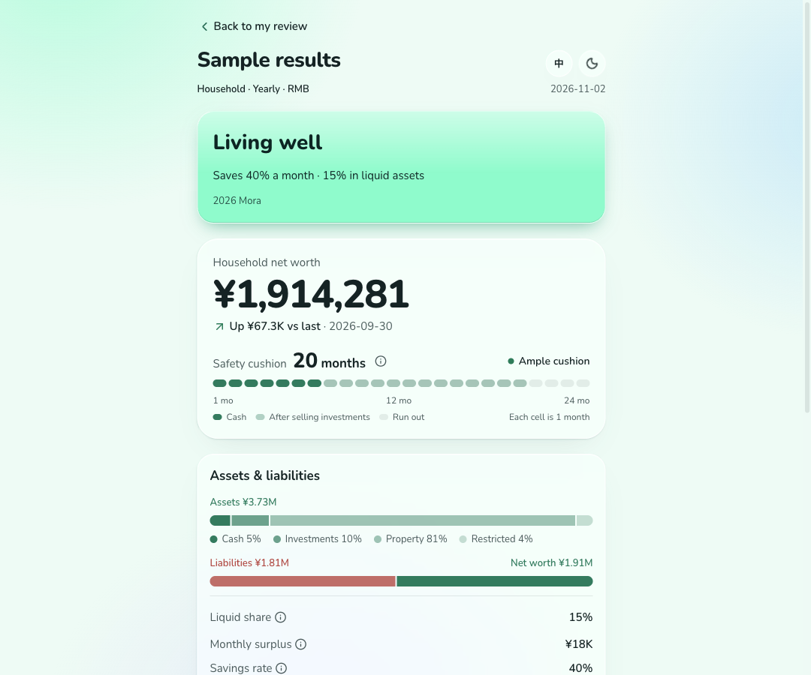
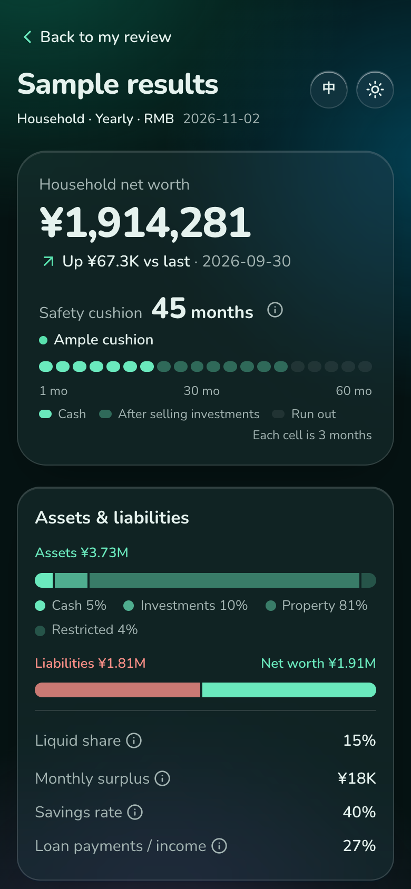

# Mora

English | [简体中文](README.zh-CN.md)

**Try it: [Mora](https://family-finance-review.vercel.app/)** · [sample results](https://family-finance-review.vercel.app/#example)

A local-first balance-sheet check-up for households. Every quarter or year, update what you own, what you owe and what comes in and goes out, then see your net worth, how it has changed, and how many months your savings would last if all income stopped. Your figures stay on your own device.

The interface is available in Simplified Chinese and English and is built for urban Chinese households, where property, mortgages, the housing provident fund and mixed RMB/USD holdings are the norm. It is a prototype.

## Local-first

Mora has no backend. Your figures are not sent anywhere unless you choose a feature that needs the network.

- **No account, no server.** The web app keeps everything in your browser's local storage. There is no database, no sign-in and no analytics. Fonts and icons are bundled, so a hosted copy only serves static files.
- **Plain files on your computer.** With the Agent Skill, each review is a JSON file in `~/.mora`, and each result page is a single HTML file that works offline. You can read, back up or delete them like any other file.
- **The network is used only when you ask:**
  - *Screenshot import* sends only the images or text you pick, straight from your browser to the AI provider you set up, with your own API key. The key is stored only in your browser.
  - *Refreshing the exchange rate* (in the web app, or `mora fx`) asks api.frankfurter.dev for the ECB reference rate. That site sees your IP address, but nothing you entered.
  - With the skill, your agent and its model provider see the material you give the agent. The CLI itself does every calculation offline.
- **Nothing is kept elsewhere.** Clearing your browser's site data deletes the web app's reviews, and there is no copy to restore them from.

<p align="center">
  
  
</p>
<p align="center"><sub>The built-in sample household, which is fictional.</sub></p>

There are three ways to use it:

1. **Enter figures by hand** in the web app. No AI needed.
2. **Import from screenshots or text** in the web app, with your own API key (Anthropic, or any OpenAI-compatible endpoint). You review every line before it is added.
3. **Ask your AI agent**, through the bundled [Agent Skill](#use-it-from-an-agent). The agent reads your material and the results open as a local HTML page.

## What it does

- **Balance sheet**: cash, investments, property, restricted assets (such as the housing provident fund), other assets and liabilities. Add as many accounts as you like, or create custom items.
- **Cash flow**: income (salary, bonuses, one-off compensation) and expenses (rent, insurance, subscriptions), each with its own frequency. Everything is converted to a monthly figure.
- **Safety cushion (安全垫)**: the number of full months current cash and investment balances can cover recorded spending and loan payments if all income stops.
- **Trend**: net worth across saved reviews, with change since the last review and since about a year ago.
- **Two currencies**: RMB and USD, converted at a daily rate. Each saved review keeps the rate it used.
- **Screenshot and text import**: recognises balances, income and spending from bank, brokerage and payroll screenshots or pasted text, proposes updating existing lines or adding new ones, and applies only the lines you tick. Card and account numbers are removed from names.
- **Chinese and English**, light and dark themes, and a mobile-first layout: on phones, editing and results are separate pages.

It is not a budgeting app and does not connect to banks. It is a snapshot you update a few times a year.

## Use it from an agent

`skills/mora/` is an [Agent Skill](https://agentskills.io) for people who already work with an AI agent such as Claude Code or Codex. The agent reads your screenshots and statements, writes the review as JSON, and runs the bundled CLI (`scripts/mora.mjs`, Node 20+, no dependencies), which does every calculation with the same engine as the web app. You check an HTML preview, confirm in chat, and only then is the review saved.

- Each review is saved as one JSON file, `~/.mora/reviews/<date>.json`, so any review can be reopened and compared month on month or year on year. The CLI looks for an existing review folder if `~/.mora` does not exist.
- Every command except `mora fx` works offline. Previews and reports use the rate recorded in the review.

To install it with the [`skills`](https://github.com/vercel-labs/skills) CLI, which detects Claude Code, Codex and other agents and copies the skill into their skills folders:

```bash
npx skills add KyrieLii/family-finance-review --skill mora
```

Add `-a claude-code` to install for one agent only, or `-g` to install for your user rather than the current project. You can also download `mora-skill-<version>.zip` from [Releases](https://github.com/KyrieLii/family-finance-review/releases) and unzip it into your agent's skills directory, for example `~/.claude/skills/`, or copy or link the folder from a clone. See [SKILL.md](skills/mora/SKILL.md) for the workflow and [format.md](skills/mora/references/format.md) for the data format.

## Getting started

Requires Node 20+ and pnpm (available through Corepack).

```bash
corepack enable
pnpm install
pnpm dev
```

| Command | What it does |
|---|---|
| `pnpm dev` | Start the dev server |
| `pnpm build` | Production build |
| `pnpm test` | Run the engine tests (Vitest) |
| `pnpm typecheck` | Type-check the project |
| `pnpm fx:update` | Refresh the USD/CNY rate in `public/fx.json` |
| `pnpm build:skill` | Rebuild the skill's CLI and its embedded report page |
| `pnpm package:release` | Pack the skill and the built web app into `release/*.zip`, after the two builds |

To host the web app, import the repository in [Vercel](https://vercel.com/new); `vercel.json` sets the build. Or deploy your own copy:

[](https://vercel.com/new/clone?repository-url=https%3A%2F%2Fgithub.com%2FKyrieLii%2Ffamily-finance-review)

A hosted copy still keeps every user's data in their own browser. Keys in `.env` are never built into a deployment.

To publish a release, set `version` in `package.json`, commit, then push a matching tag, for example `git tag v0.2.0 && git push origin v0.2.0`. GitHub Actions checks, builds and attaches the skill zip, the web zip and their checksums to the release. A tag with a suffix, such as `v0.2.0-rc.1`, is marked as a pre-release.

To use screenshot import in `pnpm dev` without typing a key, copy `.env.example` to `.env` and set `ANTHROPIC_API_KEY` (or `OPENAI_API_KEY`, `OPENAI_BASE_URL` and `FFR_AI_MODEL`). Variables already set in your shell work too. Only the dev server reads them: the key is never stored in the browser or built into `pnpm build`.

## Project structure

```text
src/
  engine/      Pure, deterministic calculation: balance sheet, cash flow, safety cushion
  lib/         Formatting, local storage and migration, theme, icons
  components/  Ledger UI (sheets, verdict, report, trend chart) and the one shadcn primitive in use
  screens/     The review page (edit and result) and the read-only sample
  report/      The standalone result page the skill's CLI writes
  cli/         The skill's CLI (bundled into skills/mora/scripts/mora.mjs)
  sample.ts    A fictional household used by the sample page
```

The engine has no UI or network dependencies, so it can be reused by other front ends later.

## Tech stack

React, Vite, TypeScript, Tailwind CSS v4, Radix (via shadcn/ui), lucide icons, Vitest.

## Disclaimer

The safety cushion is calculated from the balances and expenses entered. This tool does not provide investment, legal or real-estate advice.

## License

Copyright 2026 Kyrie Li. Licensed under the [GNU Affero General Public License v3.0](LICENSE) (AGPL-3.0-only).

You may use, change and share it, including commercially, as long as you follow the AGPL: if you distribute a modified version, or run one as a network service for others, you must make its complete source available under the same license.

If you want to use it in a closed-source product or service without those obligations, a commercial license is available: [open an issue](https://github.com/KyrieLii/family-finance-review/issues) to ask.

Contributions are welcome. By sending a pull request, you agree that your contribution may be distributed under both the AGPL and the commercial license.
