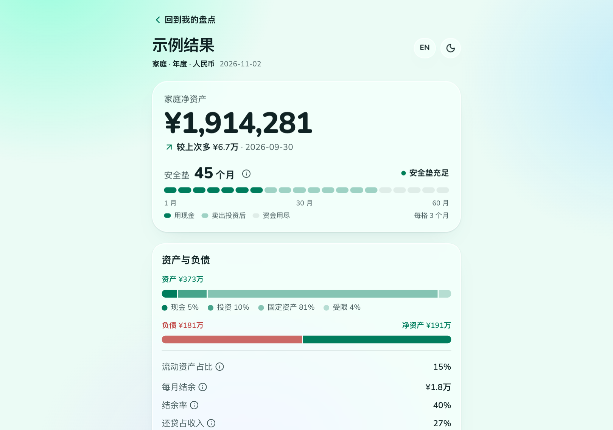
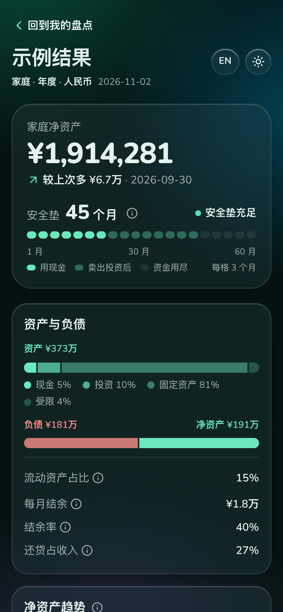

# 家庭财务盘点

[English](README.md) | 简体中文

**在线使用：[family-finance-review.vercel.app](https://family-finance-review.vercel.app/)** · [查看示例结果](https://family-finance-review.vercel.app/#example)

一个快速、私密的家庭资产负债盘点工具。每个季度或每年花几分钟，更新家里有什么、欠什么、收入和支出，就能看到净资产、和上次相比的变化，以及停止收到收入后，家里的安全垫有几个月。

产品面向中国城市家庭设计，房产、房贷、公积金、人民币和美元资产并存都是常见情况。

> 当前是原型。所有数据只保存在你的浏览器本地，不需要注册账号。使用截图导入时，你选的图片或文字会从浏览器直接发给你自己配置的 AI 服务商，不经过我们的服务器；API Key 只保存在你的浏览器里。点击汇率旁的刷新按钮时，会从 api.frankfurter.dev 获取欧洲央行参考汇率，该网站能看到你的 IP 地址，但收不到你填写的任何内容。

<p align="center">
  
  
</p>
<p align="center"><sub>内置的示例家庭，数据是虚构的。</sub></p>

有三种用法：

1. **在网页里手动录入**，不需要 AI。
2. **在网页里导入截图或文字**，用你自己的 API Key（Anthropic，或任何兼容 OpenAI 的接口）。每一行都由你核对后才加入。
3. **交给你的 AI Agent**，通过附带的 [Agent Skill](#在-agent-里使用)。Agent 读你的材料，结果以本地 HTML 页面打开。

## 功能

- **资产负债表**：现金、投资、房产、受限资产（如公积金）、其他资产和负债。每类可以添加多个账户，也可以自定义条目。
- **现金流**：收入（工资、奖金、一次性补偿）和支出（房租、保险、订阅等），每一项有自己的频率，系统统一折算成每月金额。
- **安全垫**：假设收入停止到账，以当前现金和投资余额计算可覆盖多少个月的月支出与月供，先用现金，再用投资。
- **净资产趋势**：历次盘点的净资产走势，以及环比（对比上次盘点）和同比（对比约一年前）的变化。
- **人民币和美元**：按每日汇率折算，每次保存的盘点都会记下当时用的汇率。
- **截图和文字导入**：从银行、券商、工资条截图或粘贴的文字里识别余额、收入和支出，建议更新已有条目或新增条目，只写入你勾选的行。名称里的卡号和账号会被去掉。
- **中英文、日夜主题与移动优先**：手机上录入和结果分成两页。

它不是记账软件，也不连接银行，而是一份每年更新几次的家庭财务快照。

## 在 Agent 里使用

`skills/family-finance-review/` 是一个 [Agent Skill](https://agentskills.io)，给已经在用 Claude Code、Codex 等 AI Agent 的人。Agent 负责看截图和账单、把盘点整理成 JSON，再调用附带的命令行工具（`scripts/ffr.mjs`，Node 20 以上，无依赖）。所有计算都由它完成，用的是和网页同一套引擎。你先在 HTML 预览里核对，在对话里确认后才会保存。

- 每次盘点存成一个 JSON 文件：`~/.family-finance-review/reviews/<日期>.json`。任何一次都能重新打开，也能做环比、同比。
- 结果页是单个 HTML 文件，离线可用，不上传任何数据。
- 命令行工具只有 `ffr fx` 会联网：Agent 用它从 api.frankfurter.dev 获取当天的美元兑人民币汇率。在结果页上也可以刷新或手动修改汇率，看换个汇率后的结果，已保存的盘点不会变。

用 [`skills`](https://github.com/vercel-labs/skills) 命令行工具安装，它会识别 Claude Code、Codex 等 Agent，把 skill 复制到它们的 skills 目录：

```bash
npx skills add KyrieLii/family-finance-review --skill family-finance-review
```

加 `-a claude-code` 只装给某一个 Agent，加 `-g` 装到用户目录而不是当前项目。也可以从 [Releases](https://github.com/KyrieLii/family-finance-review/releases) 下载 `family-finance-review-skill-<版本>.zip`，解压到 Agent 的 skills 目录，比如 `~/.claude/skills/`；克隆了仓库的话，直接复制或链接这个文件夹也行。流程见 [SKILL.md](skills/family-finance-review/SKILL.md)，数据格式见 [format.md](skills/family-finance-review/references/format.md)。

## 开始使用

需要 Node 20 以上版本和 pnpm（可通过 Corepack 启用）。

```bash
corepack enable
pnpm install
pnpm dev
```

| 命令 | 作用 |
|---|---|
| `pnpm dev` | 启动开发服务器 |
| `pnpm build` | 生产构建 |
| `pnpm test` | 运行计算引擎测试（Vitest） |
| `pnpm typecheck` | 类型检查 |
| `pnpm fx:update` | 更新 `public/fx.json` 中的美元兑人民币汇率 |
| `pnpm build:skill` | 重新打包 skill 的命令行工具和内嵌的结果页 |
| `pnpm package:release` | 在两次构建之后，把 skill 和网页产物打成 `release/*.zip` |

部署网页：在 [Vercel](https://vercel.com/new) 导入这个仓库即可，构建配置在 `vercel.json` 里。也可以一键部署一份自己的：

[](https://vercel.com/new/clone?repository-url=https%3A%2F%2Fgithub.com%2FKyrieLii%2Ffamily-finance-review)

部署后的网页仍然把每个人的数据存在他自己的浏览器里。`.env` 里的 Key 不会被打包进部署产物。

发布新版本：改 `package.json` 里的 `version` 并提交，再推送对应的 tag，比如 `git tag v0.2.0 && git push origin v0.2.0`。GitHub Actions 会检查、构建，并把 skill 压缩包、网页压缩包和校验文件附到 Release 上。带后缀的 tag（如 `v0.2.0-rc.1`）会标记为预发布。

想在 `pnpm dev` 里使用截图导入又不想手动填 Key：把 `.env.example` 复制成 `.env`，填上 `ANTHROPIC_API_KEY`（或者 `OPENAI_API_KEY`、`OPENAI_BASE_URL` 和 `FFR_AI_MODEL`）。终端里已经设置的环境变量也能用。只有开发服务器会读取这些变量：Key 不会存进浏览器，也不会打包进 `pnpm build` 的产物。

## 目录结构

```text
src/
  engine/      纯函数、结果确定的计算：资产负债、现金流、安全垫模拟
  lib/         格式化、本地存储与数据迁移、主题、图标
  components/  盘点界面（各类卡片、结论、报告、趋势图）和用到的 shadcn 组件
  screens/     盘点页（录入与结果）和只读示例页
  report/      skill 命令行工具生成的独立结果页
  cli/         skill 的命令行工具（打包为 skills/family-finance-review/scripts/ffr.mjs）
  sample.ts    示例页使用的虚构家庭数据
```

计算引擎不依赖界面和网络，以后可以复用到其他端，比如小程序。

## 技术栈

React、Vite、TypeScript、Tailwind CSS v4、Radix（通过 shadcn/ui）、lucide 图标、Vitest。

## 声明

本工具按用户填写的余额和支出计算安全垫，不构成投资、法律或房产交易建议。

## 许可协议

Copyright 2026 Kyrie Li。采用 [GNU Affero 通用公共许可证 v3.0](LICENSE)（AGPL-3.0-only）。

你可以使用、修改和分享，包括商业用途，前提是遵守 AGPL：分发修改后的版本，或者把修改后的版本部署成网络服务给别人用，都必须以同一协议公开完整源码。

如果想在闭源产品或服务里使用，不想承担这些义务，可以向作者购买商业授权：请[提交 issue](https://github.com/KyrieLii/family-finance-review/issues) 联系。

欢迎贡献代码。提交 Pull Request 即表示你同意你的贡献可以同时按 AGPL 和商业授权分发。
